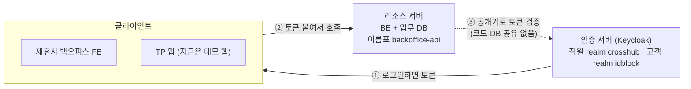
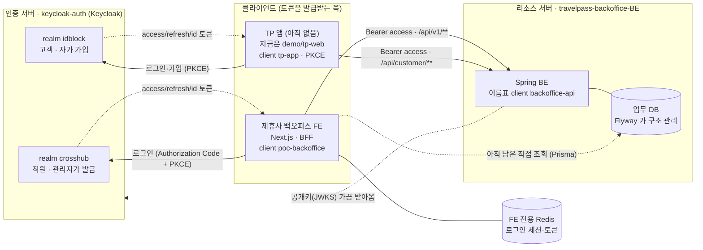
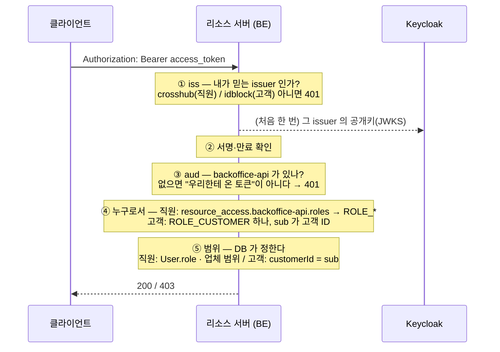
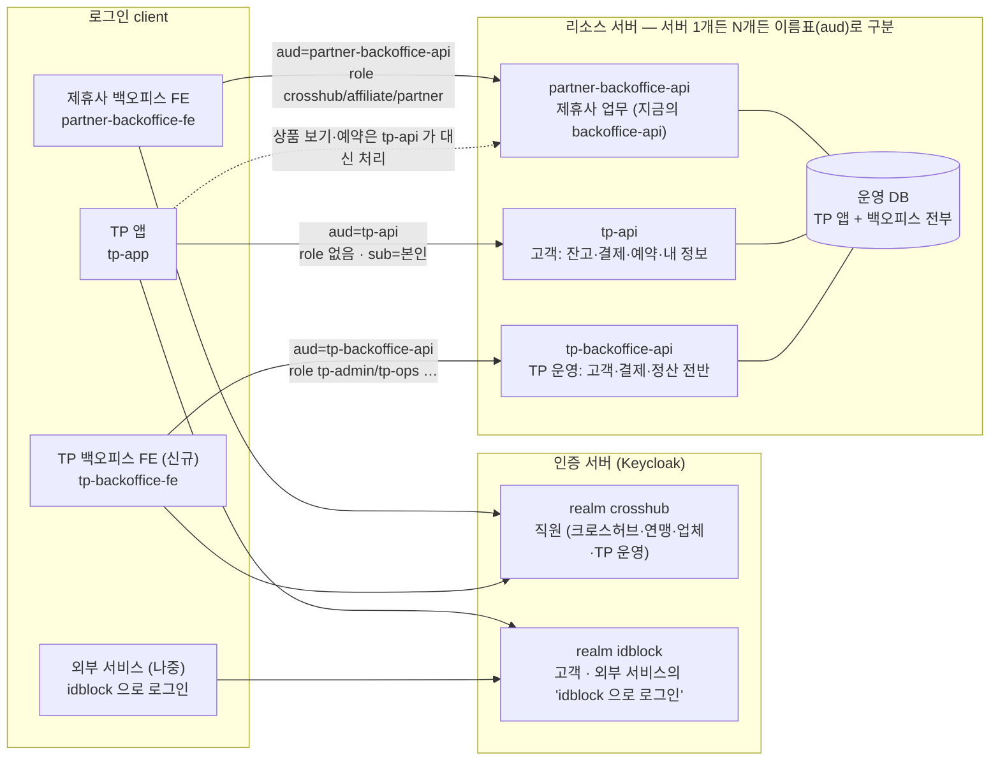

# 인증·리소스 구조 — 지금과 앞으로

2026-10-26 기준. 세부 결정은 `auth-architecture.md`, 로컬 실행은 `local-infra.md`, 앱 연동 값은 keycloak-auth 레포 `docs/tp-app-integration.md`.

## 1. 한 줄 요약

- **인증 서버(Keycloak)** 는 "이 사람이 누구인가"만 답하고 토큰을 준다.
- **리소스 서버(BE)** 는 토큰을 보고 "이걸 해도 되는가"를 정해 데이터를 내준다.
- **클라이언트(앱·FE)** 는 토큰을 받아 보관하고 리소스 서버를 부른다. 인증 서버는 보관 방식에 관여하지 않는다.
- 셋은 코드도 DB도 따로다. 리소스 서버가 인증 서버에 기대는 건 토큰 서명 확인용 공개키(JWKS) 하나뿐이다.

## 2. 지금 구조 (2026-10-26)

- 직원은 `crosshub` realm 으로, 고객은 `idblock` realm 으로 로그인한다. 둘 다 토큰에는 BE 이름표 `backoffice-api` 가 `aud` 로 들어간다.
- 직원 FE 는 `/api/v1/**`, 고객 앱은 `/api/customer/**` 를 부른다. FE 의 로그인 세션은 FE 전용 Redis 에 있다.

자세한 그림 (화살표 전부)

### 아직 덜 떨어진 곳 하나

제휴사 FE 가 **업무 조회(Prisma 읽기 73곳)와 감사 기록(작업·접근·로그인 기록)** 은 아직 BE DB 를 직접 읽고 쓴다. 로그인 세션과 "내가 누구인가"는 이미 뗐다(Redis + `/api/v1/me`). 남은 것은 모듈 단위로 BE API 로 옮긴다.

## 3. realm 과 client

**realm = 사용자 풀.** 직원과 고객은 가입 방식도, 비밀번호 정책도, 토큰 수명도 다르므로 realm 을 나눈다. 발급처가 다르니 고객 토큰으로는 직원 API 를 부를 수 없다.

**client 는 두 종류다.**

| 종류 | 뜻 | 지금 있는 것 |
|---|---|---|
| **로그인 client** | 사람이 로그인해서 토큰을 **발급받는** 앱 | `poc-backoffice` (FE, confidential), `tp-app` (앱, public + PKCE) |
| **이름표 client** | 토큰을 발급받지 않는다. 리소스 서버를 가리키는 이름. 토큰의 `aud` 에 들어가고 그 서버용 role 이 여기 붙는다 | `backoffice-api` (두 realm 에 같은 이름) |
| (서버 간 호출) | 사람이 없는 service account | `backoffice-admin-api` (BE 가 직원 계정을 발급할 때 Keycloak 관리 API 호출) |

| realm | client | 종류 | 용도 |
|---|---|---|---|
| `crosshub` | `poc-backoffice` | 로그인 · confidential | 제휴사 백오피스 FE. audience mapper 로 `aud=backoffice-api`, scope mapping 으로 직원 role 포함 |
| `crosshub` | `backoffice-api` | 이름표 | 직원 client role `crosshub` / `affiliate` / `partner` 가 여기 붙음 |
| `crosshub` | `backoffice-admin-api` | service account | 계정 발급·비번 초기화 |
| `idblock` | `tp-app` | 로그인 · public + PKCE | TP 앱(과 브라우저 데모). audience mapper 로 `aud=backoffice-api` |
| `idblock` | `backoffice-api` | 이름표 | 고객은 role 없음, `aud` 용도만 |

## 4. 리소스 서버가 토큰에서 보는 것 — 권한 4단계

| 단계 | 질문 | 어디서 | 지금 값 |
|---|---|---|---|
| **iss** | 누가 발급했나 (직원 realm? 고객 realm?) | 토큰 claim | `…/realms/crosshub`, `…/realms/idblock` |
| **aud** | 어느 리소스 서버용 토큰인가 | 토큰 claim (이름표 client) | `backoffice-api` |
| **role** | 그 서버 안에서 무엇을 할 수 있나 | 토큰 `resource_access.<이름표>.roles` + DB `User.role` (둘이 같아야 함) | 직원 `crosshub/affiliate/partner`, 고객은 없음 |
| **범위** | 어떤 데이터까지 | DB | 크로스허브 전체 / 연맹은 대행 업체 / 업체는 자기 업체 / 고객은 본인(`customerId`) |

`azp`(토큰을 받아간 로그인 client)는 **보지 않는다.** 로그인 client 이름에 BE 를 묶으면 client 가 늘 때마다 BE 를 고쳐야 한다. BE 는 자기 이름표(`aud`)만 본다.

## 5. 앞으로의 구조

TP 앱이 실제로 생기면 고객은 "백오피스 DB 의 상품·예약"만이 아니라 **자기 잔고·결제·금액** 같은 TP 전반을 본다. 크로스허브가 운영하는 **TP 백오피스**도 따로 생겨 TP 앱 관련 전반을 본다. 제휴사 백오피스는 지금처럼 제휴사 업무만 본다. DB 는 TP 앱·백오피스가 다 들어가는 실제 운영 DB 가 되고, 서버가 하나일지 나뉠지는 아직 정하지 않았다.

**바뀌지 않는 것**
- realm 은 그대로 두 개. 직원이 늘면(TP 운영팀) `crosshub` realm 에 사람을 더 넣고 role 을 더 만든다. 고객은 계속 `idblock`.
- 토큰 검사 4단계도 그대로. 새 리소스 서버가 생기면 이름표 client 를 하나 더 만들고(두 realm 에), 로그인 client 에 그 aud 를 넣어 주면 끝. 인증 서버 코드는 안 바뀐다.
- 고객 범위는 항상 `sub = 본인`. 잔고·결제가 생겨도 "내 것만"이라는 규칙이 같다.

**새로 정해야 하는 것**
- 리소스 서버를 하나로 둘지(API 표면만 `aud` 로 나눔) 서비스로 나눌지. 어느 쪽이든 이름표 client 는 표면마다 하나다.
- TP 백오피스 role 이름(예: `tp-admin`, `tp-ops`)과 그 범위. `crosshub` role 과의 관계(크로스허브 직원이 둘 다 갖는지).
- 운영 DB 의 소유자. 지금은 제휴사 백오피스 BE 가 Flyway 로 구조를 관리한다. 서버가 나뉘면 스키마 소유를 어떻게 나눌지.
- 이름표 이름 정리: 지금 `backoffice-api` 를 `partner-backoffice-api` 로 바꿀지(바꾸면 토큰 aud·BE 설정·realm 셋 다 같이).

## 6. 지금까지 한 것 / 남은 것

| 끝남 | 남음 |
|---|---|
| 인증 서버 레포 분리 (`keycloak-auth`, private) | FE 업무 조회·감사 기록을 BE API 로 (모듈 단위 PR) |
| realm 두 개 (`crosshub`, `idblock`) + 이름표 client | 소셜 로그인 (Identity Provider 추가) |
| BE: issuer 두 개 신뢰, aud 검사, 직원/고객 경로 분리 | SMTP (이메일 인증·비번 재설정 메일) |
| `GET /api/v1/me`, FE 세션 Redis | 운영 주소·HTTPS, `tp-app` 에서 localhost redirect 제거 |
| 고객용 API (상품·예약·문의) + 예약·문의에 고객 ID (V2) | TP 백오피스·tp-api 설계 (위 "새로 정해야 하는 것") |
| 브라우저 데모 `demo/tp-web`, 앱 연동 가이드 | TP 앱 실제 개발 |
