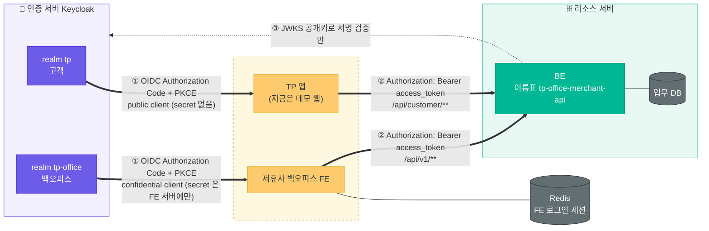
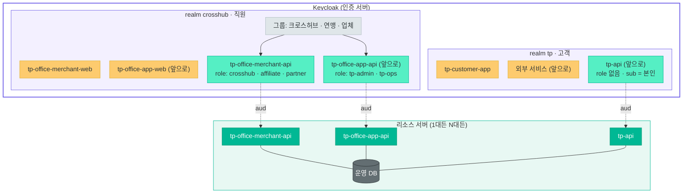
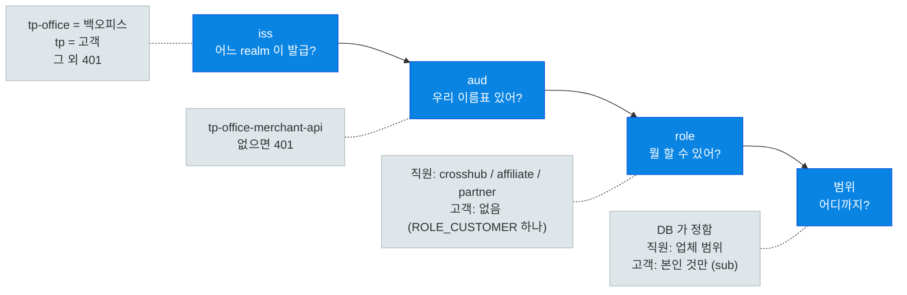
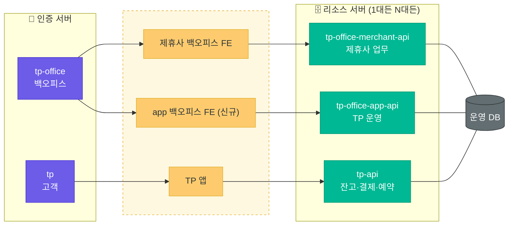

# 인증·리소스 구조 — 지금과 앞으로

2026-10-26. 노션 "인증·리소스 구조" 페이지와 같은 내용. 세부 결정은 `auth-architecture.md`.

> 세 덩어리로 나눴다. **인증 서버**는 로그인만, **리소스 서버**는 데이터만, **클라이언트**는 토큰 들고 왔다 갔다. 셋은 코드도 DB도 따로.

## 지금



- 직원은 `tp-office` realm, 고객은 `tp` realm 으로 로그인. realm 이 다르면 사용자 풀이 다른 거라 고객 토큰으로 직원 API 못 부름.
- 로그인은 둘 다 OIDC Authorization Code + PKCE. 차이는 FE 는 서버(BFF)가 있어 client secret 도 같이 쓰고(토큰은 브라우저에 안 내림), 앱은 secret 을 둘 데가 없어 PKCE 만. 로그인 화면은 둘 다 Keycloak 이 그림.
- FE 로그인 세션은 FE 전용 Redis. FE 가 DB 를 직접 읽는 데가 아직 좀 남아 있음(업무 조회, 감사 기록). 모듈별로 BE API 로 옮기는 중.

## client 두 종류

| | 뭐냐 | 지금 |
|---|---|---|
| 🟡 **로그인 client** | 사람이 로그인해서 토큰 받는 앱 | `tp-office-merchant-web` (FE), `tp-customer-app` (앱) |
| 🟢 **이름표 client** | 로그인 안 함. 리소스 서버 이름. 토큰 `aud` 에 박히고 role 이 여기 붙음 | `tp-office-merchant-api` (두 realm 에 같은 이름) |

## 큰 틀 한 장

client 이름 (2026-10-27 확정). 서비스마다 로그인(`-web`)·이름표(`-api`)·계정 관리 service account(`-svc`) 세 개씩.

| 서비스 | client |
|---|---|
| app 백오피스 (앞으로) | `tp-office-app-web` / `tp-office-app-api` / `tp-office-app-svc` |
| merchant 백오피스 (지금 앱 — 크로스허브·연맹·업체) | `tp-office-merchant-web` / `tp-office-merchant-api` / `tp-office-merchant-svc` |
| TP 앱 (tp) | `tp-customer-app` |

realm 은 사람 풀, 로그인 client 는 앱, 이름표 client 는 API. role 은 이름표 밑에, 사람은 그룹으로 묶어 role 을 받는다. 직원은 realm 하나(크로스허브·연맹·업체 다). 그래야 우리 직원이 한 번 로그인으로 두 백오피스를 다 들어가고, 제휴사 직원은 role 이 없어 제휴사 백오피스만 들어간다.



노랑 = 로그인 client (앱) · 연두 = 이름표 client (API, role 은 여기 밑에) · 회색 = 그룹 · 진초록 = 리소스 서버 · 점선 = aud

지금은 이름표가 `tp-office-merchant-api` 하나고 두 realm 에 같은 이름으로 있다. 위 그림은 거기에 `tp-office-app-api`·`tp-api` 가 더 생긴 모양.

직원 realm 을 안 나누는 이유: SSO 는 realm 안에서만 된다. 세션 길이·OTP·들어갈 수 있는 앱은 client 와 role 로 나뉘고, 못 나누는 건 비번 규칙과 잠금 정책뿐. 그게 달라져야 하면 그때 realm 을 가르고 브로커로 SSO 를 잇는다.

## BE 가 토큰에서 보는 순서



`azp`(어느 앱이 받아간 토큰인지)는 안 봄. 앱이 늘 때마다 BE 고치기 싫어서.

## 토큰은 이렇게 생겼다

OIDC 로 로그인하면 토큰 세 개가 온다. BE 에 보내는 건 **access token** 하나. JWT 라 점 두 개로 나뉘고(헤더.본문.서명), 본문은 base64 를 풀면 그냥 JSON 이다. 암호화가 아니라 누구나 읽을 수 있고, 대신 서명 때문에 못 고친다.

| 토큰 | 누구 주는 거 | 어디 쓰나 |
|---|---|---|
| access_token | BE 에 | 매 요청 `Authorization: Bearer …`. 5분 |
| refresh_token | 인증 서버에 | access 만료되면 새로 받기. 직원 30분, 고객 30일 |
| id_token | 앱 자기한테 | "로그인한 사람 이름 보여주기". BE 에 안 보냄 |

**직원 access token 본문** (test-crosshub, tp-office realm)

```json
{
  "iss": "http://localhost:8080/realms/tp-office",   // ① 어느 realm 이 발급했나 → 직원
  "aud": "tp-office-merchant-api",                          // ② 우리 이름표. 없으면 BE 가 401
  "azp": "tp-office-merchant-web",                          //    토큰을 받아간 앱. BE 는 안 봄
  "sub": "e4c288e3-…",                              //    Keycloak 사용자 id
  "preferred_username": "test-crosshub",            //    BE 가 User.loginId 로 찾는 키
  "resource_access": {
    "tp-office-merchant-api": { "roles": ["crosshub"] }    // ③ 이름표 밑에 붙은 role → ROLE_CROSSHUB
  },
  "name": "크로스허브 운영팀",
  "exp": 1792984000, "iat": 1792983700,             //    만료·발급 (5분)
  "sid": "lwZWtlZt…"                                //    SSO 세션. 백채널 로그아웃이 이걸로 FE 세션을 찾음
}
```

**고객 access token 본문** (test-customer, tp realm)

```json
{
  "iss": "http://localhost:8080/realms/tp",    // ① 고객 realm
  "aud": "tp-office-merchant-api",                          // ② 같은 이름표
  "azp": "tp-customer-app",
  "sub": "15cdc824-284f-4b5c-99ac-1993b021079e",    // ④ 고객 ID. Booking.customerId 에 이 값이 들어감
  "email": "test-customer@example.com",
  "email_verified": true,
  "name": "테스트 고객",
  "scope": "openid email profile",
  "exp": 1792984300, "iat": 1792984000
  // resource_access 없음 → ③ role 없음. BE 가 ROLE_CUSTOMER 하나만 줌
}
```

두 토큰의 차이는 `iss` 하나와 role 유무뿐. BE 는 `iss` 로 직원/고객을 가르고, `aud` 로 우리 것인지 확인하고, 직원은 role · 고객은 `sub` 로 범위를 정한다.

## 앞으로

TP 앱이 진짜 생기면 고객은 잔고·결제까지 봄. TP 운영용 백오피스도 따로 생김. DB 는 하나로 갈지 서버를 나눌지 미정. **어느 쪽이든 리소스 서버마다 이름표 하나씩** 이면 끝.



정해야 할 것
- 서버를 나눌지, 하나에 API 만 나눌지
- app 백오피스 role 이름

## 프로덕션 전 하드닝 체크리스트

설계는 그대로 두고 운영만 조이는 목록. 위에서부터 순서대로.

**배포 전 필수 (하루)**

- [ ] Keycloak `start-dev` → `start`, `KC_HOSTNAME` 운영 주소로 고정, HTTPS 만 허용 (`sslRequired: all`)
- [ ] 운영 realm 의 `tp-customer-app`·`tp-office-merchant-web` redirect/webOrigins 에서 localhost 제거, 운영 도메인만
- [ ] client secret·DB 비번·`SESSION_ENCRYPTION_KEY`·관리자 비번을 `.env` 파일이 아니라 배포 플랫폼 비밀 변수로. 개발·운영 값 분리
- [ ] Keycloak 부트스트랩 관리자 비번 교체, 관리 콘솔(`/admin`) 접근을 사내망·VPN 또는 IP 로 제한, 관리자 OTP
- [ ] BE `CORS_ALLOWED_ORIGINS` 운영 도메인만. `app.auth.disabled` 가 운영에서 켜질 수 없게 확인
- [ ] FE 세션 쿠키 `secure` 확인(운영 NODE_ENV), Upstash `REDIS_URL` 은 TLS(`rediss://`)

**첫 달 안에 (운영)**

- [ ] Keycloak DB 백업·복구 절차. realm JSON 은 설정이고 사용자·비번은 DB 에만 있다
- [ ] Keycloak 업그레이드 절차 (버전 고정 → 스테이징에서 먼저 → 운영). 지금 26.8.1 고정
- [ ] 이벤트 로깅 켜기: 로그인 실패·잠금·토큰 거절·관리자 변경. 수집해서 알림 하나는 걸어 둘 것 (잠금 폭증, 관리자 로그인)
- [ ] BE 에서 401/403 비율 모니터링. aud 불일치·issuer 불일치는 설정 실수 신호
- [ ] 서명키 회전은 Keycloak 이 하지만, BE 가 JWKS 를 다시 받는지 한 번 확인 (키 추가 → 새 토큰 검증)
- [ ] SMTP 연결: 고객 비번 재설정·이메일 인증, 직원 임시 비번 전달 경로
- [ ] 계정 생명주기: 직원 퇴사 → 비활성화(있음). 고객 탈퇴 → Keycloak 사용자 삭제 + 예약·문의의 개인정보 처리 규칙 (없음)
- [ ] 진짜 Keycloak 을 띄우고 도는 통합 테스트 한 벌 (지금 BE 테스트는 전부 가짜 토큰)
- [ ] FE 가 DB 를 직접 읽는 나머지를 BE API 로 (업무 조회 73곳, 감사 기록). 끝나면 FE 의 DB 접속 정보 자체를 없앨 수 있다

**TP 앱에 돈이 들어가면 (tp-api)**

- [ ] 결제·잔고 변경 API 는 재인증(step-up): `max_age` 또는 OTP 조건 흐름
- [ ] 그 API 용 access 수명 더 짧게 (client 별 설정), refresh 재사용 허용 0 검토
- [ ] 토큰 탈취 대비 기기 바인딩(DPoP) 검토. Keycloak 26 지원
- [ ] 금액 변경 감사 로그는 수정 불가 저장(append-only), 누가·언제·어느 토큰(sub·sid)으로
- [ ] 고객용 API 속도 제한(rate limit), 고객 가입에 봇 방어

## 한 것 / 할 것

| ✅ 한 것 | ⬜ 할 것 |
|---|---|
| 인증 서버 레포 분리 (`keycloak-auth`) | FE 남은 DB 직접 조회를 BE 로 |
| realm 2개 + 이름표 client | 소셜 로그인 |
| BE 가 두 realm 토큰 검증, 직원/고객 경로 분리 | 이메일(SMTP) |
| FE 세션 Redis, `/api/v1/me` | 운영 주소·HTTPS |
| 고객용 API (상품·예약·문의) | app 백오피스·tp-api 설계 |
| 브라우저 데모 `demo/tp-web` | TP 앱 개발 |
