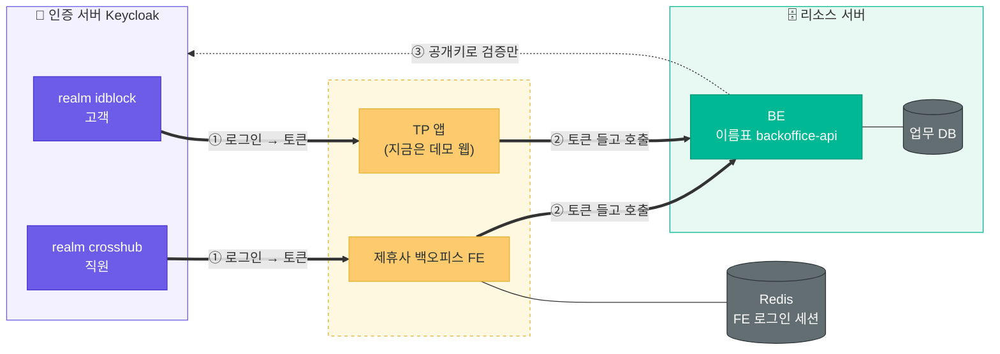
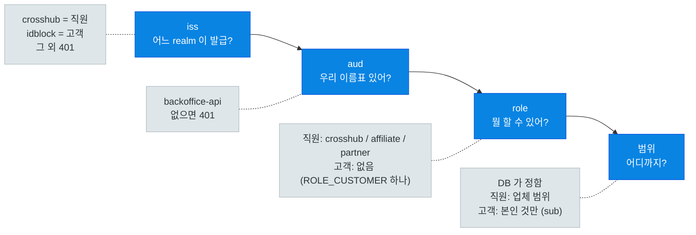
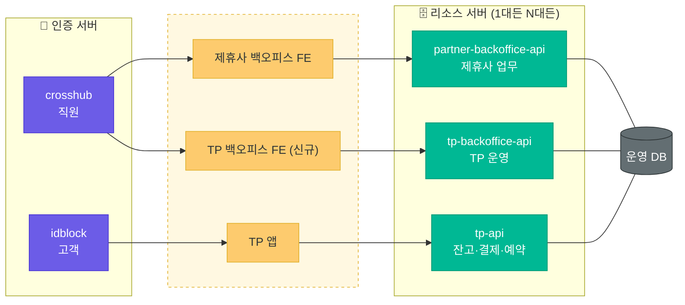

# 인증·리소스 구조 — 지금과 앞으로

2026-10-26. 노션 "인증·리소스 구조" 페이지와 같은 내용. 세부 결정은 `auth-architecture.md`.

> 세 덩어리로 나눴다. **인증 서버**는 로그인만, **리소스 서버**는 데이터만, **클라이언트**는 토큰 들고 왔다 갔다. 셋은 코드도 DB도 따로.

## 지금

- 직원은 `crosshub` realm, 고객은 `idblock` realm 으로 로그인. realm 이 다르면 사용자 풀이 다른 거라 고객 토큰으로 직원 API 못 부름.
- FE 로그인 세션은 FE 전용 Redis. FE 가 DB 를 직접 읽는 데가 아직 좀 남아 있음(업무 조회, 감사 기록). 모듈별로 BE API 로 옮기는 중.

## client 두 종류

| | 뭐냐 | 지금 |
|---|---|---|
| 🟡 **로그인 client** | 사람이 로그인해서 토큰 받는 앱 | `poc-backoffice` (FE), `tp-app` (앱) |
| 🟢 **이름표 client** | 로그인 안 함. 리소스 서버 이름. 토큰 `aud` 에 박히고 role 이 여기 붙음 | `backoffice-api` (두 realm 에 같은 이름) |

## BE 가 토큰에서 보는 순서

`azp`(어느 앱이 받아간 토큰인지)는 안 봄. 앱이 늘 때마다 BE 고치기 싫어서.

## 앞으로

TP 앱이 진짜 생기면 고객은 잔고·결제까지 봄. TP 운영용 백오피스도 따로 생김. DB 는 하나로 갈지 서버를 나눌지 미정. **어느 쪽이든 리소스 서버마다 이름표 하나씩** 이면 끝.

정해야 할 것
- 서버를 나눌지, 하나에 API 만 나눌지
- TP 백오피스 role 이름
- `backoffice-api` 를 `partner-backoffice-api` 로 바꿀지

## 한 것 / 할 것

| ✅ 한 것 | ⬜ 할 것 |
|---|---|
| 인증 서버 레포 분리 (`keycloak-auth`) | FE 남은 DB 직접 조회를 BE 로 |
| realm 2개 + 이름표 client | 소셜 로그인 |
| BE 가 두 realm 토큰 검증, 직원/고객 경로 분리 | 이메일(SMTP) |
| FE 세션 Redis, `/api/v1/me` | 운영 주소·HTTPS |
| 고객용 API (상품·예약·문의) | TP 백오피스·tp-api 설계 |
| 브라우저 데모 `demo/tp-web` | TP 앱 개발 |
